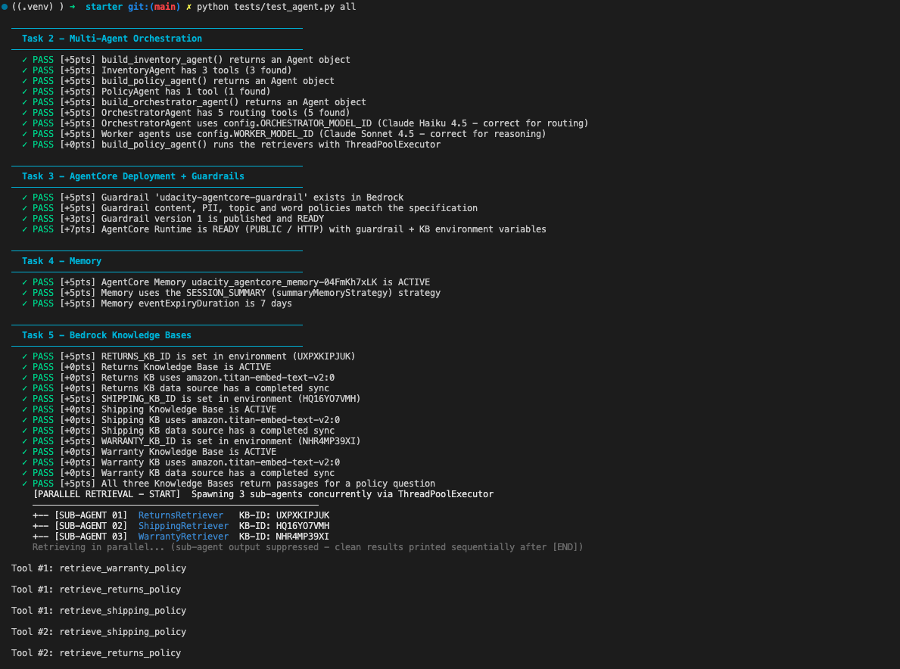
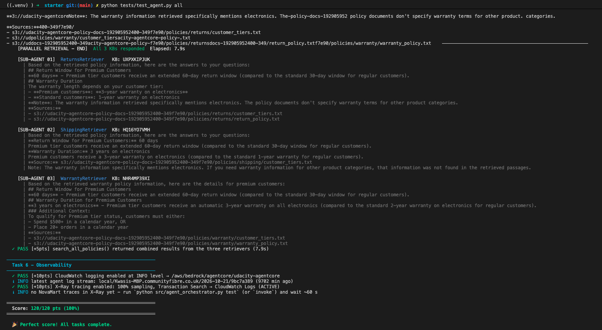
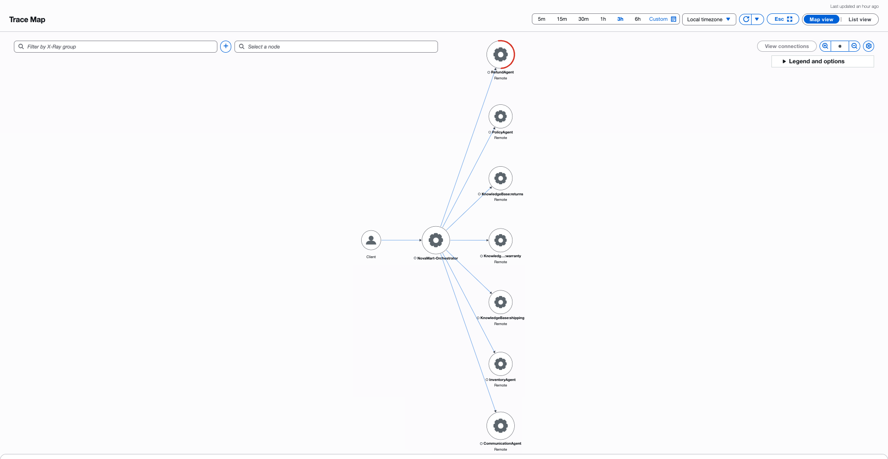
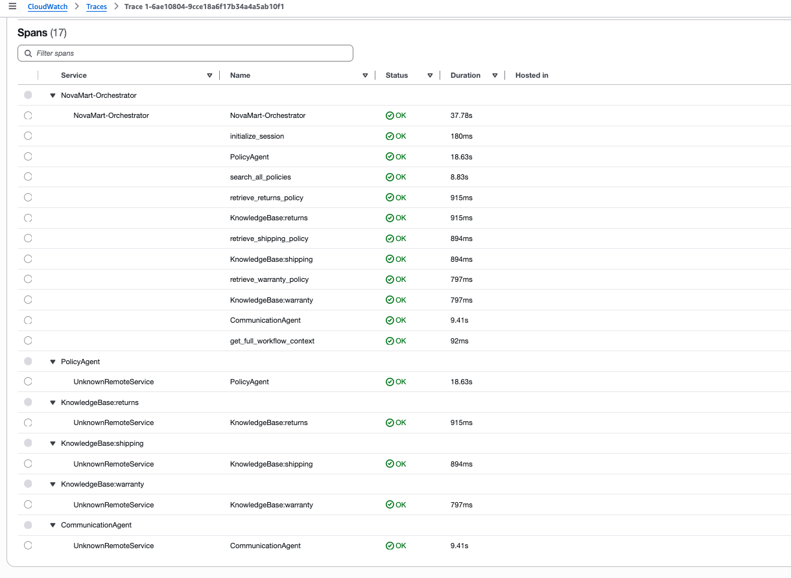

# Project evidence

## Automated tests

Ran `python tests/test_agent.py all`. 

Result: **120/120 points (100%)**.

## X-Ray tracing

The Trace Map shows NovaMart-Orchestrator, all four worker agents, and the returns, shipping, and warranty Knowledge Bases.

The policy request trace (`1-6ae10804-9cce18a6f17b34a4a5ab10f1`) shows PolicyAgent, all three Knowledge Base retrievals, and CommunicationAgent. It recorded **17 spans, 0 faults, and 0 errors**.

The full map includes a RefundAgent fault from an initial call; the orchestrator retried that call successfully.